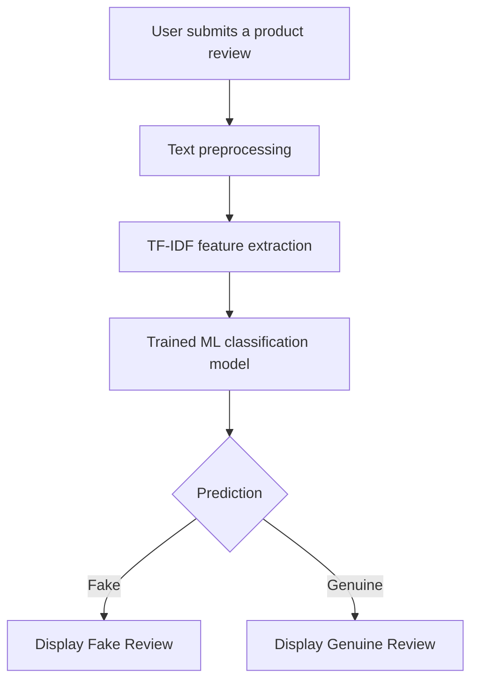

# 🕵️ Fake Review Detection Using Machine Learning and NLP


**Can a product review be trusted? Use Machine Learning to identify potentially fake reviews.**

A Machine Learning and Natural Language Processing (NLP) web application that analyzes online review text and classifies reviews as **Fake or Genuine**.

🔗 **GitHub Repository:** [Fake Review Detection Using ML and NLP](https://github.com/aditijamkar-04/Fake-Review-Detection-Using-ML-and-NLP)

---

## 🌟 Project Overview

Online reviews play an important role in how people choose products and services. Before making a purchase, customers often depend on other users' experiences and ratings.

However, not every online review represents a genuine customer experience. Fake or misleading reviews can influence product ratings and affect purchasing decisions.

I developed this project to explore how Machine Learning and NLP can help identify potentially deceptive reviews.

The application analyzes review text, converts it into numerical features using **TF-IDF**, and uses trained classification models to predict whether a review is fake or genuine.

The project combines text preprocessing, feature extraction, machine learning, model training, and web application development.

---

## ✨ Features at a Glance

| **Feature** | **Description** |
|---|---|
| 📝 Review Analysis | Analyze submitted review text |
| 🤖 Fake Review Detection | Classify reviews as Fake or Genuine |
| 🧹 Text Preprocessing | Prepare raw review text for machine learning |
| 🔢 TF-IDF Feature Extraction | Convert text into numerical features |
| 🌳 Random Forest | Use a trained classification model for prediction |
| 🧠 ML Model Experimentation | Work with Logistic Regression, Naive Bayes, and Random Forest |
| 🌐 Web Interface | Interact with the application through a frontend |
| 🔗 Backend Integration | Connect the frontend with the machine learning functionality |

---

## 📸 Application Screenshots

Here is a look at the main sections of the application.

> Add your actual application screenshots to a `screenshots/` folder in the repository and use the filenames below.

| 🏠 Home Page | 📝 Review Input |
|---|---|
|  |  |

| 🤖 Prediction Result | 📊 Model Output |
|---|---|
|  |  |

---

## ⚙️ How It Works

The application follows a machine learning workflow to analyze review text and generate a classification.

### 🔄 Project Workflow



### 🧪 Example

**Input Review:**

> This product is absolutely amazing!!! Best purchase ever!!! Everyone should buy it!!!

**Possible Classification:**

The model analyzes the text and produces a prediction based on patterns learned during training.

**Another Example:**

> The product works well for everyday use. The battery lasts most of the day, although charging takes longer than expected.

**Possible Classification:**

The model evaluates the review text and predicts whether it is Fake or Genuine.

*These examples are illustrative. Actual predictions depend on the trained model and the input text.*

---

## 🧠 Machine Learning Approach

The project uses Natural Language Processing to prepare review text for classification.

### 1. Text Preprocessing

Raw text needs to be cleaned before it can be used by a machine learning model.

The preprocessing stage prepares the review text by handling unnecessary text elements and standardizing the input.

### 2. TF-IDF Feature Extraction

TF-IDF stands for Term Frequency–Inverse Document Frequency.

Machine learning algorithms cannot directly understand raw text. TF-IDF converts text into numerical features that a model can process.

It helps identify words that are important in a review compared with how frequently they appear across the dataset.

### 3. Model Training and Classification

The project explores different classification algorithms:

| **Algorithm** | **Purpose** |
|---|---|
| Logistic Regression | Classify reviews using learned statistical relationships |
| Naive Bayes | Apply probability-based text classification |
| Random Forest | Combine multiple decision trees for classification |

The trained model is used to classify submitted reviews.

---

## 🛠️ Technology Stack

| **Category** | **Technologies** |
|---|---|
| Programming Language | Python |
| Machine Learning | Scikit-learn |
| NLP | Natural Language Processing |
| Feature Extraction | TF-IDF |
| Data Processing | Pandas, NumPy |
| Classification Models | Logistic Regression, Naive Bayes, Random Forest |
| Backend | Python |
| Frontend | React, JavaScript |
| Frontend Build Tool | Vite |
| Model Storage | Pickle (`.pkl`) |
| Version Control | Git, GitHub |

---

## 🧩 Project Structure

```text
Fake-Review-Detection-Using-ML-and-NLP/
│
├── Backend_1/
│   ├── model/
│   │   └── rf_model.pkl
│   │
│   └── ...                  # Backend and ML-related files
│
├── frontend/
│   ├── public/
│   ├── src/
│   ├── package.json
│   └── ...                  # React frontend files
│
├── .gitattributes
├── .gitignore
└── README.md
```

---

## 🚀 Getting Started

Follow these steps to set up the project locally.

### 1. Clone the repository

```bash
git clone https://github.com/aditijamkar-04/Fake-Review-Detection-Using-ML-and-NLP.git
cd Fake-Review-Detection-Using-ML-and-NLP
```

### 2. Set up the Python backend

Open a terminal and navigate to the backend folder:

```bash
cd Backend_1
```

Create a virtual environment:

```bash
python -m venv venv
```

Activate it on Windows PowerShell:

```powershell
.\venv\Scripts\Activate.ps1
```

Install the required Python dependencies:

```bash
pip install -r requirements.txt
```

### 3. Set up the frontend

Open another terminal and navigate to the frontend folder:

```bash
cd frontend
```

Install the frontend dependencies:

```bash
npm install
```

### 4. Run the application

Start the backend using its Python application entry point and start the frontend using:

```bash
npm run dev
```

Open the local URL displayed in the frontend terminal.

*Note: Start the backend using the actual entry-point file included in `Backend_1`. The frontend and backend must both be running for the complete application to work.*

---

## 🧠 Challenges and Learning Outcomes

Building this project helped me understand how machine learning can be applied to a real-world problem.

Some of the key areas I worked on:

- Collecting and preparing review data for model training.
- Understanding text preprocessing techniques.
- Converting textual data into numerical features using TF-IDF.
- Exploring different machine learning classification algorithms.
- Training and using a classification model.
- Connecting machine learning functionality with a web application.
- Developing frontend and backend components.
- Testing predictions and debugging application issues.

**My biggest takeaway:** Machine learning models do not understand text the way humans do. Text preprocessing and feature extraction play an important role in helping models identify meaningful patterns.

---

## 🔮 Future Improvements

- Improve model performance through further experimentation.
- Explore advanced NLP techniques and deep learning models.
- Add more detailed prediction explanations.
- Support bulk review analysis.
- Expand testing with different types of product reviews.
- Improve the user interface and overall user experience.

---

## 👩‍💻 About the Project

This project was developed as a hands-on exploration of Machine Learning, Natural Language Processing, and web application development.

It helped me strengthen my understanding of:

- Python programming.
- Data preprocessing and analysis.
- NLP and TF-IDF feature extraction.
- Machine learning model development and training.
- Classification algorithms.
- Frontend and backend integration.
- Testing and debugging.

**Thanks for visiting! ⭐ If you find this project interesting, feel free to explore the repository.**
